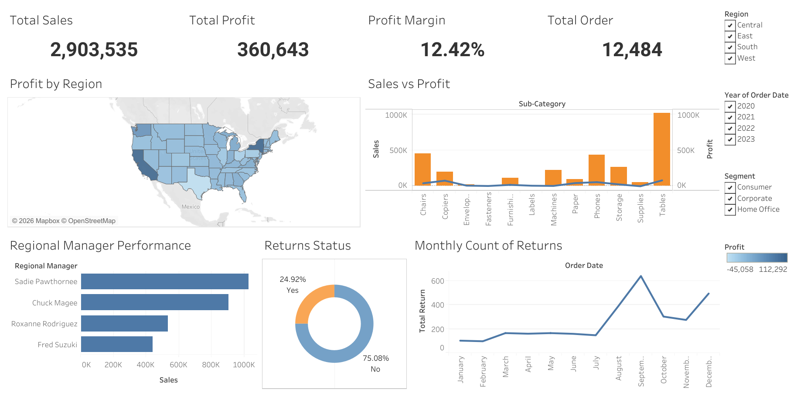
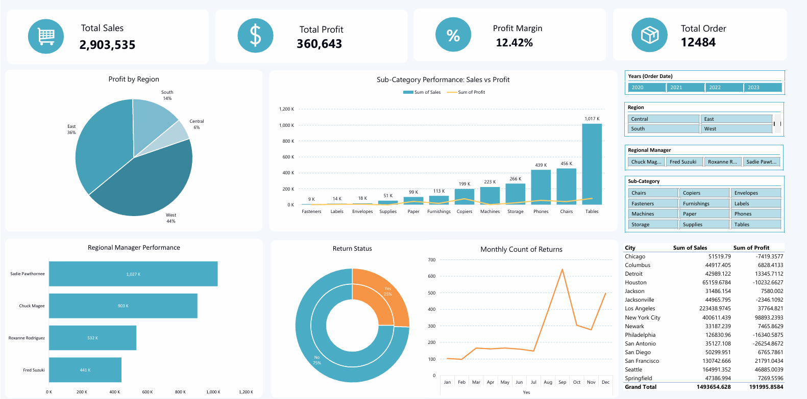

# Superstore Performance Analysis

An end-to-end data analysis project focused on preparing Superstore data with **Microsoft Excel and Power Query**, then exploring business performance through an Excel dashboard and an interactive Tableau dashboard.

## Project Overview

This project brings together the provided Superstore source files, transforms the data into a consolidated clean dataset, and presents the analysis through dashboard visualizations. The repository separates the original source files, the processed dataset, dashboard screenshots, and the final analysis report.

## Objectives

- Prepare and organize the available Superstore source files.
- Use Power Query to transform the source data into `superstore_clean.xlsx`.
- Explore sales and profitability performance from different business perspectives.
- Present the analysis in Excel and Tableau dashboards.
- Document the project and make the results easy to review.

## Tools & Technologies

- **Microsoft Excel** — spreadsheet review and dashboarding.
- **Power Query** — data transformation and preparation.
- **Tableau Public** — interactive data visualization and dashboard publishing.

## Data Sources

The files below are kept in `data/raw/` as the project's original inputs:

| File | Description |
|---|---|
| `Master-Sub-Category.csv` | Sub-category reference data. |
| `Orders_Clean.xlsx` | Orders data provided as an input file. |
| `Order_People.csv` | People/reference data provided with the dataset. |
| `Order_Return.csv` | Returns data provided with the dataset. |
| `Superstore.xlsx` | Superstore source workbook. |
| `Superstore_by_Region.xlsx` | Superstore data organized by region. |

The processed output is stored at `data/processed/superstore_clean.xlsx` and was produced through the Power Query workflow. The exact transformations should be reviewed in the workbook if implementation-level details are needed.

## Data Preparation Workflow

1. Collect the original CSV and Excel files in `data/raw/`.
2. Review the source tables and prepare them using Power Query.
3. Load the resulting clean dataset as `data/processed/superstore_clean.xlsx`.
4. Use the prepared data for analysis and dashboard creation.
5. Capture dashboard previews and include the final report in the repository.

## Dashboard Preview

### Tableau Dashboard



View the interactive dashboard on Tableau Public:

**[Open Superstore Dashboard on Tableau Public](https://public.tableau.com/views/superstore_17716805443000/Dashboard1?:language=en-US&:sid=&:redirect=auth&:display_count=n&:origin=viz_share_link)**

### Excel Dashboard



> The images above are loaded from the `dashboard/` directory. Add the corresponding screenshot files there using the filenames shown in this README.

## Analysis Report

The project report is available here:

[`reports/superstore-analysis-report.pdf`](https://github.com/AlphaMirror-ID/superstore-performance-analysis/blob/main/reports/superstore-analysis-report.pdf)

The report provides additional context for the analysis and its findings.

## Repository Structure

```text
superstore-performance-analysis/
├── README.md
├── data/
│   ├── raw/
│   │   ├── Master-Sub-Category.csv
│   │   ├── Orders_Clean.xlsx
│   │   ├── Order_People.csv
│   │   ├── Order_Return.csv
│   │   ├── Superstore.xlsx
│   │   └── Superstore_by_Region.xlsx
│   └── processed/
│       └── superstore_clean.xlsx
├── dashboard/
│   ├── dashboard-overview-tableau.png
│   └── dashboard-overview-excel.png
└── reports/
    └── superstore-analysis-report.pdf
```

## Notes

- Keep the raw input files separate from the processed output so the preparation workflow is easier to understand.
- If any source files are too large or restricted from redistribution, add instructions for obtaining them rather than committing them to the repository.
- Replace or update the dashboard screenshots whenever the published dashboards change.

## Author

**Data Analyst Portfolio Project**
